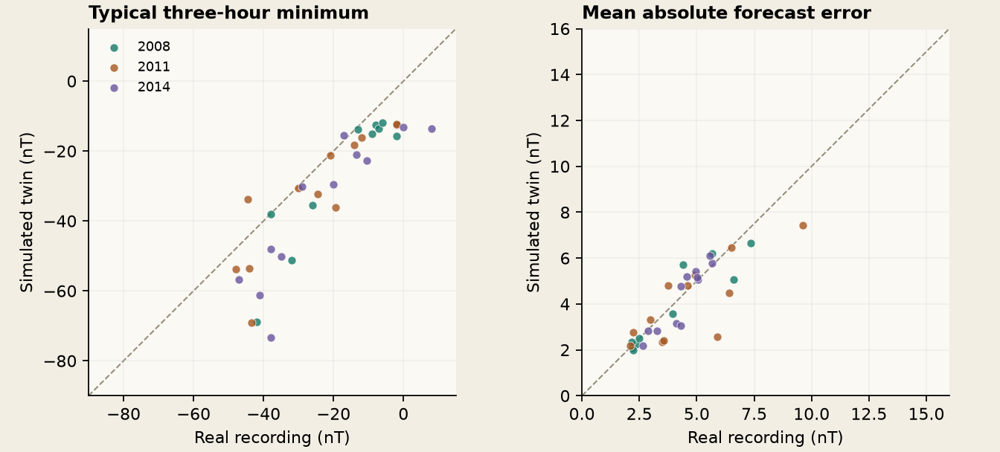

# StormNet v1.0.1

At the end of a UTC hour, StormNet predicts the lowest of the **next three complete hourly Dst values**, in nanotesla, with a symmetric nominal 68% prediction interval. The primary exam spans 2016–2020. StormNet's mean absolute error was 3.47 nT across 43,439 issues. Published O’Brien–McPherron physics scored 3.45 nT and holding the last index fixed scored 3.79 nT.

**The headline, plainly (17 Nov 2026).** StormNet was then examined a second time on the sealed 2022–2025 reserve, at solar maximum: 33,068 forecasts in 85 storm blocks, including the May 2024 superstorm (−406 nT). It beats holding the last index fixed by a wide margin and beats published physics on every storm row, but it **ties ring-current physics tuned on the same dev storms** and loses on the most extreme hours. The network adds nothing measurable over its own physics anchor. v1.0.1 keeps v1.0's forecasts and widens its error bars by how deep the storm already is.

Dst (disturbance storm time) measures how much the horizontal magnetic field near Earth’s equator changes. A large negative excursion marks an intense geomagnetic storm.

## What a forecast knows

Supply 36 completed hourly observations of GSM Bz, solar-wind speed and dynamic pressure, plus the last completed hour’s Dst. At issue 08:00 UTC the latest input averages 07:00–08:00. Verification covers 08:00–09:00, 09:00–10:00 and 10:00–11:00. Every competitor has the same cutoff. A past observation may fill an instrument gap for up to two hours per field. Missing index truth is never interpolated.

OMNI shifts upstream measurements to estimated arrival at Earth before taking hourly averages. The historical Dst series also includes later revisions. These results measure retrospective forecasting conditional on an available index. An operational lead-time claim would require time-stamped as-received telemetry. [NASA OMNI2 documentation](https://omniweb.gsfc.nasa.gov/html/ow_data.html)

## Physics and learning

The driver is the southward motional electric field, E = V max(−Bz, 0) / 1,000 mV/m. Each current state follows dR/dt = Q − R/τ. In the published single-state system Q = −4.4 max(E − 0.49, 0) nT/h and τ = 2.4 exp[9.74/(4.69 + E)] hours. The observed index adds 7.26√P − 11 nT to the current. The exact constant-driver exponential update preserves the sign of injection. The two-state simulator partitions injection between fast and slow reservoirs and gives each a different lifetime. They are effective components of the disturbance, with no claim that one index uniquely identifies both physical populations. [Burton, McPherron & Russell, 1975](https://doi.org/10.1029/JA080i031p04204) · [O’Brien & McPherron, 2000](https://doi.org/10.1029/1998JA000437) · [Ring-current decay rates in magnetic storms](https://doi.org/10.1029/2000JA000430)

- On a 96-hour drive, shutoff and pressure jump, maximum disagreement with independent SciPy DOP853 integration was 4.3 × 10⁻¹⁴ nT for the published system and 8.5 × 10⁻¹³ nT for two states. The quiet pressure jump from 2 to 8 nPa was +10.267 nT. All 744 hours of March 2011 matched Kyoto's final monthly publication exactly in value and UTC alignment.
- Real 1998–2004 solar-wind trajectories and their short instrument gaps supply the simulated storms' driving conditions. They preserve the joint changes in field, pressure and speed. Each simulation has 48 hours of warm-up, 36 hours of input and three future hours for the target. The simulator varies injection, lifetimes and pressure response, and adds an autocorrelated disturbance term. Both the history's Dst reading and the supervised minimum come from the simulator. Historical Dst is excluded by the training loader.
- Dev calibration fit injection, lifetime and pressure coefficients directly to real forecast residuals. For R3 the fit gave gain 7.045, fast and slow lifetime factors 0.406 and 1.422, fast share 0.596 and pressure coefficient 2.00 at its lower bound. Current Dst corrects total simulated state at issue. The past wind sets the split between states. Future electric field and square-root pressure relax toward training-era means, with hourly autoregression coefficients 0.757 and 0.931.
- The network corrects the physical forecast using 15 causal features, 48 fixed random tanh features and two fitted linear readouts. The location readout uses iterated robust ridge regression. A disjoint fifth of the simulation bank trains the log-error scale. The released artifact stores 926 numbers, including normalization, fixed hidden weights and 128 fitted output coefficients. Inference requires only NumPy. The float32 export differs from training precision by less than 0.000003 nT on dev.

## Dev and the ratchet

The protocol was committed before opening any Dst series. Among whole storms and 72-hour quiet blocks in 2008, 2011 and 2014, seed 1729 chose 34 blocks with 2,408 eligible hourly issues. Storm blocks join Dst ≤ −50 crossings at most 72 hours apart and include 24 hours on either side. Dev sampling roughly spans the within-year storm-depth distribution. No dev, primary or reserve year contributes training wind. Both frozen validation banks have 4,500 synthetic cases driven exclusively by 2005 wind. Each training bank has 17,000 synthetic cases.

| Rung | Change | Frozen v1 skill | Frozen v2 skill | v2 decision |
|---|---|---:|---:|---|
| R1 | Instantaneous wind and last Dst | 0.1612 | 0.1091 | Kept |
| R2 | Wind history and physical state estimate | 0.1545 | 0.1197 | Kept after replay |
| R3 | Calibrated two-state teacher and anchor | — | 0.1340 | Released |
| R4 | Mixture of single- and two-state banks | — | 0.1291 | Rejected |

Skill averages improvements over persistence on all issues and on targets ≤ −50. A gain must exceed 0.01 and each dev year's error ratio can worsen by at most 5%. R2 failed on v1 and passed after physics changed and the ladder was replayed. R3 improved on R2 in each dev year. The three-seed diagnostic is in `training/seed_check.json`. One alternate seed gave an R3–R2 gain of only 0.0048. The release is the preregistered seed 103.

In the paired twin test, the released network saw the same wind as each real dev case and four independent simulated index histories. Mean absolute errors under two-state physics were 3.56, 4.12 and 4.41 nT against 3.67, 4.70 and 4.48 nT on the corresponding recordings. The year-specific correlations of signed errors were 0.70, 0.63 and 0.55. The simulated minima were typically 8–14 nT too negative. Matching error magnitudes left an absolute-level mismatch. [Dev twin measurements](training/twin.json)

A separate onset check asked whether a warning preceded the first crossing of −50 nT in each selected dev storm. All 16 storms had three eligible forecasts. StormNet warned on 12/16 (75%, 95% Wilson interval 51–90%), published physics on 9/16, both dev-tuned physical models on 15/16, and persistence on 0/16. Median warning time on hits was one hour before the crossing hour ended for every method that warned. This descriptive dev check was recorded after release selection. [Every dev onset and warning time](training/onsets_dev.json)

## v1.1 attempts, all decided on dev before the reserve was opened

A dev diagnostic (`training/dev_diagnostic.py`) re-ran the tuned physics with the actual next three hours of wind, which no forecast has. Dev error only fell from 4.36 to 4.21 nT, and rose in main phases (6.65 → 7.34 nT), so the remaining error is the physics and the index's hourly noise, not the unknown wind. Forecasts sat too shallow in recovery (−3.1 nT mean residual).

| Attempt | Dev result | Decision |
|---|---|---|
| Physics: assimilate the fast/slow split from the window's observed Dst | storm MAE 11.77 → 11.69 / 8.63 → 8.62 / 6.61 → 6.61 nT; all-issue MAE worse in 2011 and 2014 | rejected |
| Physics: pressure-dependent injection, γ = 0.106 (Wang, Chao & Lin 2003) | storm MAE 11.77 → 11.33 / 8.63 → 8.57 nT, 2014 worse (6.61 → 6.79) | rejected |
| R5: readout reading the window's 36 hourly Dst values, 256 random units | val2 0.1283 / 0.1410 / 0.1283 (seeds 103–105, mean 0.1325 against R3's 0.1340); every dev year worse | rejected |
| Error bars binned by the last observed Dst | dev coverage at Dst ≤ −50 nT 54.6% → 68.1% (factors 1.575 / 1.232 / 1.092) | v1.0.1 |

The plan named electric-field bins for the error bars. On dev those bins were already covered (69%, 64%, 68%), so the bins follow the last observed Dst instead; that change was recorded before the reserve was opened. On Windows the rebuild reproduces the calibration to about 1e-8 but not the banks' bit-level fingerprints; R3 rebuilt there scores exactly 0.1340 on val2.

## Exam 1: the primary exam

The release, all opponents and the scoring program were committed at `6fc38b3` before downloading 2016–2020. Of 43,848 hours, 43,810 admit the required past and future. Wind gaps excluded 371 more, leaving **43,439**. The 2022–2025 reserve stayed sealed until exam 2 below.

| Exam row | Issues / blocks | StormNet | Last Dst | Published O’Brien | Dev-tuned O’Brien | Dev-tuned two-state | Difference vs best, 95% interval | Verdict |
|---|---:|---:|---:|---:|---:|---:|---|---|
| All, MAE (nT) | 43,439 / 629 | 3.466 | 3.789 | 3.447 | 3.478 | 3.516 | +0.019 [−0.011, +0.048] | Tie |
| Minimum ≤ −50 nT, MAE (nT) | 811 / 51 | 9.636 | 12.587 | 10.479 | 9.534 | 9.487 | +0.149 [−0.221, +0.519] | Tie |
| Minimum ≤ −100 nT, MAE (nT) | 57 / 5 | 17.763 | 23.053 | 18.368 | 17.899 | 18.152 | −0.136 [−2.077, +2.045] | Tie |
| Minimum ≤ −150 nT, MAE (nT) | 7 / 1 | 26.078 | 33.286 | 33.096 | 27.379 | 27.988 | −1.301, one independent storm | Inconclusive |
| False alarm on minimum > −50 nT (%) | 42,628 / 629 | 0.296 | 0.232 | 0.169 | 0.378 | 0.373 | +0.127 [+0.078, +0.180] percentage points | Loss |

The bootstrap draws whole blocks 2,000 times, preserving the mix of storm and quiet blocks. Each draw compares StormNet to its best classical or persistence comparator. Rows with fewer than five blocks are informational. Seven extreme issues come from the same storm, so a between-storm interval cannot be estimated. Quiet false alarms count issues where the predicted minimum crossed −50 nT and the observed minimum stayed above it.

Dev widened the predicted half-width by 1.1675. Coverage was 71.7% overall (95% block interval 70.9–72.5%), 49.0% at storm strength (44.9–53.4%), 40.4% for intense forecasts (26.5–68.6%) and 42.9% for the seven extreme issues. On quiet targets coverage was 72.1% (71.4–72.9%). The all-hour result is dominated by quiet conditions. [Full exam and weight fingerprint](training/exam.json) · [Annual OMNI file fingerprints](training/sources_primary.json)

## Exam 2: the sealed reserve, 2022–2025

Opened once on 17 Nov 2026 after the v1.0.1 decisions were committed (`a36824b`), with the primary exam's rows, bootstrap seed and rules (`training/exam_reserve.py`). This is solar maximum: 33,068 forecasts in 515 blocks, 85 of them storms; the deepest is the block from 9 May 2024 (−406 nT). In OMNI these years carry Kyoto's provisional or quicklook Dst. Point forecasts are v1.0's; v1.0.1 changes only the bars.

| Exam row | Issues / blocks | StormNet | Last Dst | Published O’Brien | Dev-tuned O’Brien | Dev-tuned two-state | Difference vs best, 95% interval | Verdict |
|---|---:|---:|---:|---:|---:|---:|---|---|
| All, MAE (nT) | 33,068 / 515 | 4.356 | 5.030 | 4.343 | 4.582 | 4.654 | +0.013 [-0.029, +0.055] | Tie |
| Minimum ≤ −50 nT, MAE (nT) | 1,992 / 85 | 10.690 | 14.198 | 11.676 | 10.616 | 10.650 | +0.074 [-0.206, +0.341] | Tie |
| Minimum ≤ −100 nT, MAE (nT) | 310 / 21 | 23.650 | 30.206 | 26.745 | 23.086 | 23.468 | +0.564 [-0.151, +1.238] | Tie |
| Minimum ≤ −150 nT, MAE (nT) | 108 / 8 | 36.158 | 44.074 | 41.014 | 34.991 | 35.882 | +1.167 [+0.070, +2.161] | Loss |
| False alarm on minimum > −50 nT (%) | 31,076 / 515 | 0.615 | 0.460 | 0.376 | 0.875 | 0.917 | +0.238 [+0.178, +0.304] percentage points | Loss |

68% coverage, v1.0 → v1.0.1: all hours 65.3 → 63.2%, storm-strength 51.5 → 59.9%, intense 41.9 → 52.9%, extreme 41.7 → 50.9%. The bars are better where storms are and still too narrow there. [Full reserve exam](training/exam_reserve.json) · [Reserve OMNI fingerprints](training/sources_reserve.json)

The site's instrument replays six whole storms chosen by rule (`training/storm_gallery.py`): the deepest storm of each reserve year, the deepest primary-exam storm and one quiet block drawn by seed. It reruns every hourly forecast and all three physics competitors in the browser.

## Limits and next experiments

1. Rare, rapidly deepening storms have the largest errors and narrowest effective coverage. The five-year sample contains one independent extreme storm.
2. The forecast inherits uncertainty about the next three hours of wind. A north-to-south field rotation occurring after issue can drive a storm faster than the causal projection predicts.
3. One Dst reading constrains the sum of the states. The pressure coefficient reached its search bound, and twin absolute minima were too deep. A time-stamped quicklook stream and independent wind-pressure responses would test the observation model.

The reserve is now spent: the next version has no fresh real exam until 2026 is complete, so its decisions rest on dev and simulation, and any re-score on these years is labelled seen. The dev diagnostic rules out the future-wind ensemble as the main lever (knowing the actual wind helps 0.15 nT). The promising lever is physics the anchor lacks, so the network has something real to learn: a By- or substorm-dependent injection term, or a ring-current asymmetry term fitted on SYM-H, each shown failing on dev first.

## Data and credit

NASA Space Physics Data Facility, OMNIWeb, and the contributing solar-wind instrument teams supplied the hourly field and plasma measurements. Cite King & Papitashvili (2005). World Data Center for Geomagnetism, Kyoto, M. Nose and colleagues, and the contributing observatories supplied the geomagnetic Dst index. Kyoto permits scientific use with acknowledgement and prohibits commercial application of its geomagnetic indices. Four short primary-exam excerpts drive the offline demo; six whole storms from both exams (`examples/storms.npz`) drive the browser instrument and lab. [OMNI source](https://omniweb.gsfc.nasa.gov/html/ow_data.html) · [OMNI paper](https://doi.org/10.1029/2004JA010649) · [Kyoto Dst DOI](https://doi.org/10.17593/14515-74000) · [Provider terms](https://wdc.kugi.kyoto-u.ac.jp/wdc/Sec3.html)
